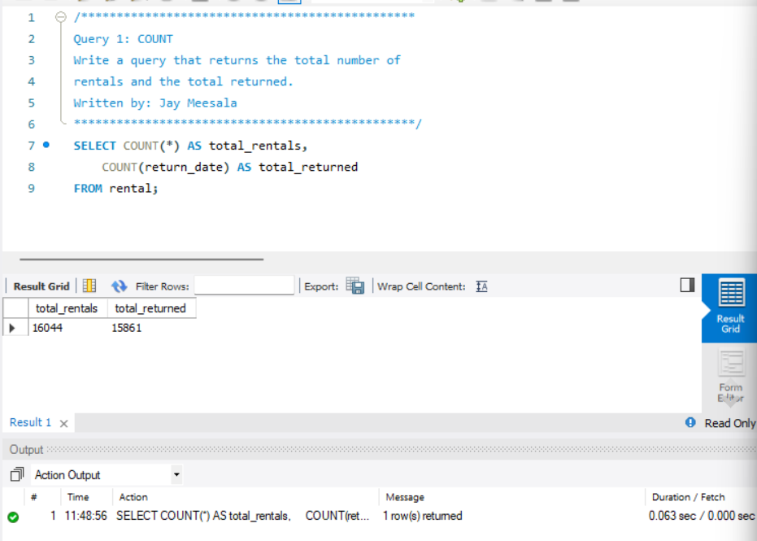
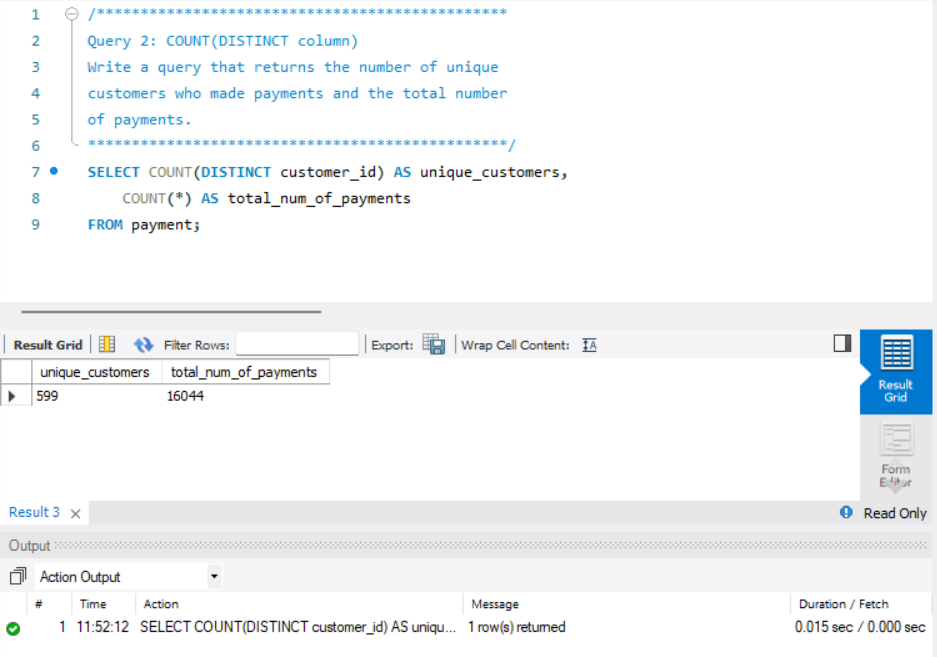
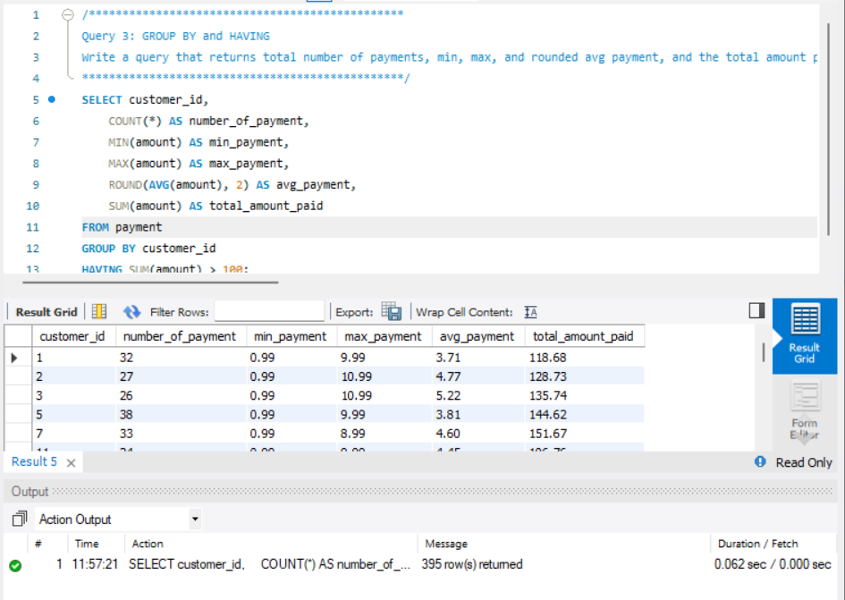
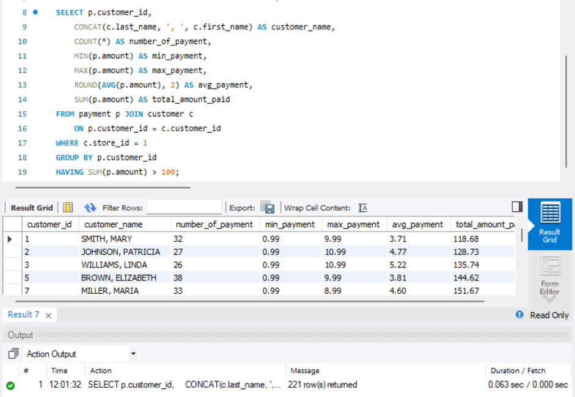
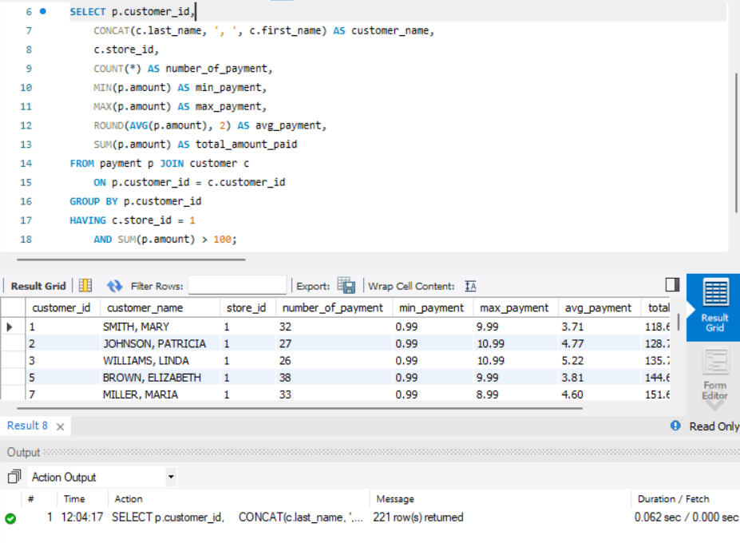
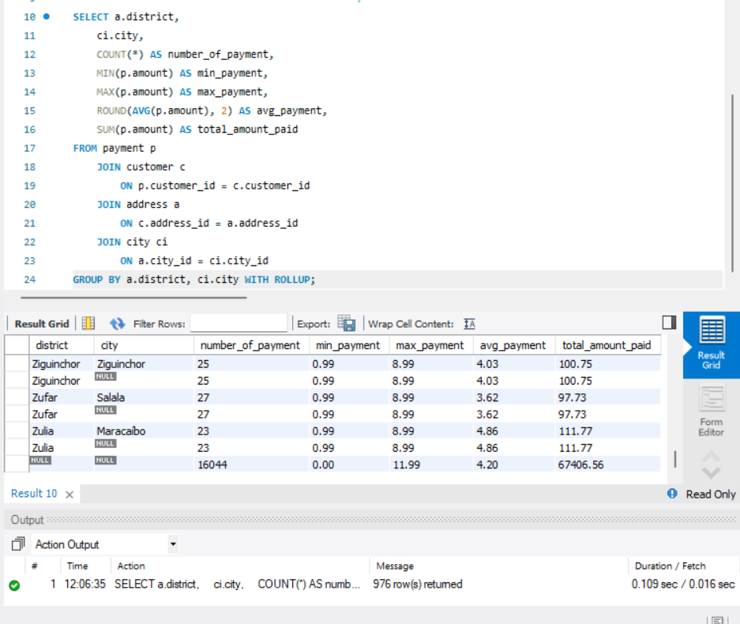
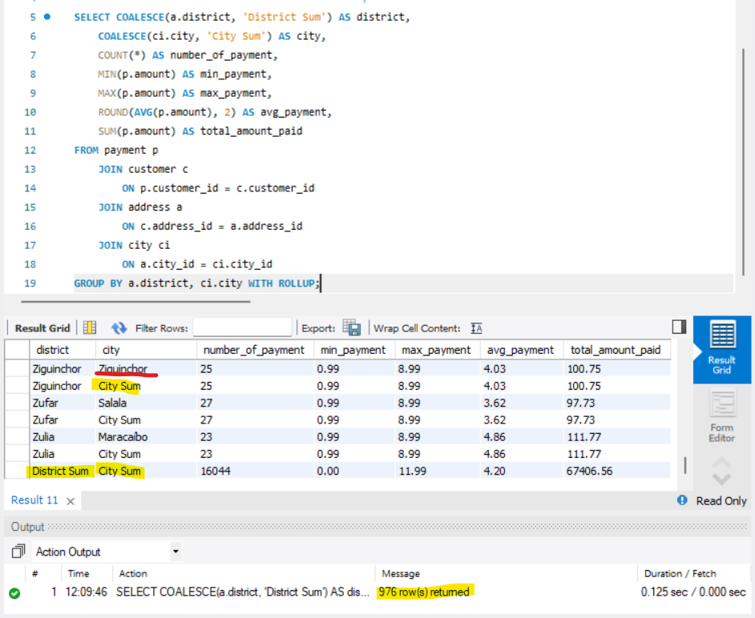

# Ch6_Summary_Queries

Welcome! This project uses the Sakila database to practice summary queries using the SQL concepts in Chapter 6.

---

## Project Overview

This project demonstrates how to:

- Count all rentals and rentals that have been returned
- Count unique customers who made payments
- Summarize payments for each customer using `COUNT`, `MIN`, `MAX`, `AVG`, and `SUM`
- Filter grouped results with `HAVING`
- Display customer names alongside payment summaries
- Compare filtering with `WHERE` and `HAVING`
- Summarize payments by district and city using `WITH ROLLUP`
- Label summary rows using `COALESCE`

The SQL queries are in [Query.txt](https://github.com/shakoooni/Ch6_Summary_Queries/blob/main/Query.txt).

Repository: [shakoooni/Ch6_Summary_Queries](https://github.com/shakoooni/Ch6_Summary_Queries)

---

## Technologies Used

- MySQL
- Sakila sample database
- MySQL Workbench

---

## Features

- Counts total rentals and returned rentals
- Compares the number of unique paying customers with the total number of payments
- Shows payment count, minimum, maximum, average, and total for customers who paid more than $100
- Adds each customer's name to the payment summary
- Limits results to store ID `1` using `WHERE`, then rewrites the filter using `HAVING`
- Produces district, city, and grand total rows with `WITH ROLLUP`
- Replaces `NULL` summary labels with **City Sum** and **District Sum**

---

## New Concepts Used

`COUNT(column)`, `COUNT(DISTINCT column)`, `MIN`, `MAX`, `AVG`, `ROUND`, `SUM`, `GROUP BY`, `HAVING`, functionally dependent columns, `WITH ROLLUP`, and `COALESCE`.

---

## Console Output Testing Example

### Query 1: COUNT

Count all rentals and rentals with a return date.

### Query 2: COUNT(DISTINCT column)

Count unique customers who made payments and the total number of payments.

### Query 3: GROUP BY and HAVING

Summarize payments for each customer whose total paid is greater than $100.

### Query 4: Functionally Dependent Column

Add each customer's name to the payment summary.

### Query 5: WHERE vs HAVING - Part 1

Use `WHERE` to limit the results to customers from store ID `1`.

### Query 6: WHERE vs HAVING - Part 2

Display `store_id` and move the store filter to `HAVING`.

### Query 7: WITH ROLLUP

Summarize payments by district and city, including summary rows and a grand total.

### Query 8: COALESCE

Replace the `NULL` values in the summary rows with **City Sum** and **District Sum**.

---

## Author

**Jay Meesala**  
GitHub: [@shakoooni](https://github.com/shakoooni)
